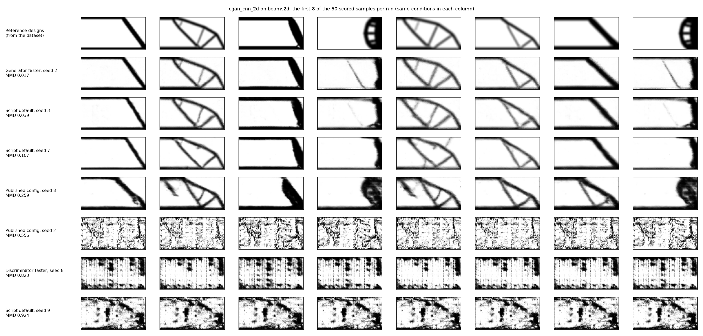

# Seed sensitivity of the EngiOpt cGAN baseline on Beams2D

How much does the outcome of training the [EngiOpt](https://github.com/IDEALLab/EngiOpt) `cgan_cnn_2d` baseline on `beams2d` depend on the random seed, and do the two learning rates explain it? This relates to [EngiOpt issue 81](https://github.com/IDEALLab/EngiOpt/issues/81). It is independent work, not part of the EngiOpt project.

**Start with the notebook: [`cgan_beams2d_seed_study.ipynb`](cgan_beams2d_seed_study.ipynb).** It is saved with its outputs, so it can be read without running anything.

## Main results

Four pairs of learning rates, ten seeds each, everything else fixed. "Collapsed" means that the samples of a run vary less than half as much as the reference designs.

| Arm | Generator lr | Discriminator lr | MMD above 0.1 | Collapsed | Violation rate, min to max |
|---|---|---|---|---|---|
| Script default | 1e-4 | 4e-4 | 8 of 10 | 7 of 10 | 0.56 to 0.96 |
| Published 11-seed configuration | 3e-4 | 3e-4 | 6 of 10 | 3 of 10 | 0.26 to 0.96 |
| Generator faster | 1e-3 | 1e-4 | 0 of 10 | 0 of 10 | 0.12 to 0.86 |
| Discriminator faster | 1e-4 | 1e-3 | 5 of 10 | 4 of 10 | 0.38 to 0.98 |

With a faster generator and a slower discriminator no run collapsed, but the constraint violation rate still varied widely with the seed.

## Limits

One model on one problem, ten seeds per arm. The runs use EngiOpt commit `7a98ba5` and evaluation spec `beams2d/v1`, and have not been rescored with the newer evaluation code. The thresholds are my choice. The study shows that the collapse depends on the learning rates and the seed. It does not establish why. The notebook has the full list.

## Contents

- `data/`: scores of the 40 runs, the sample spread of each run, and the published metrics from the Hugging Face repository [`IDEALLab/engiopt-cgan-cnn-2d`](https://huggingface.co/IDEALLab/engiopt-cgan-cnn-2d).
- `figures/`: sample designs drawn from the trained generators, with reference designs from the EngiBench Beams2D dataset.
- `code/`: scripts for training, scoring and drawing. The notebook's last section gives the steps.

To rerun the notebook: `pip install jupyter pandas scipy matplotlib`. The trained generators are not included.
